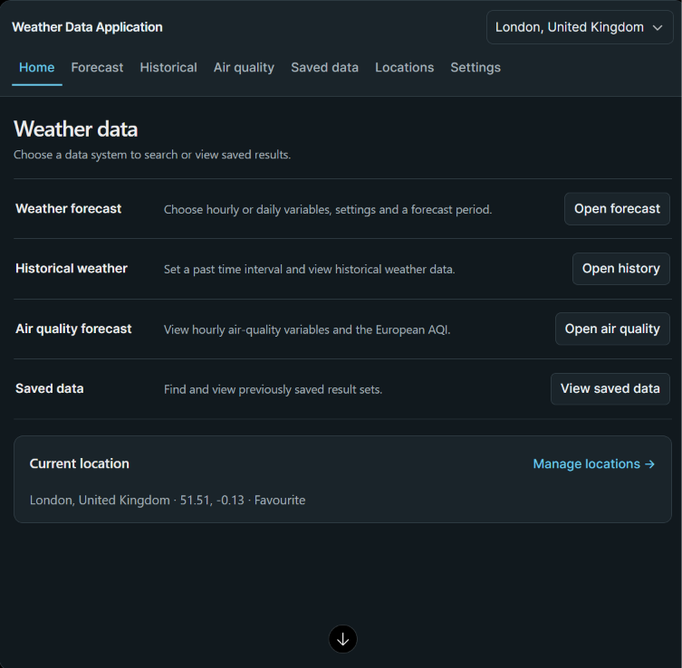
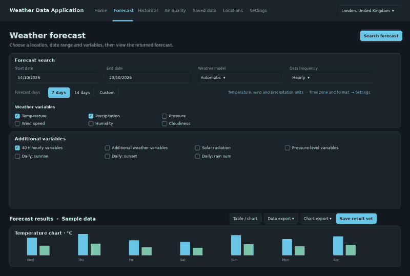
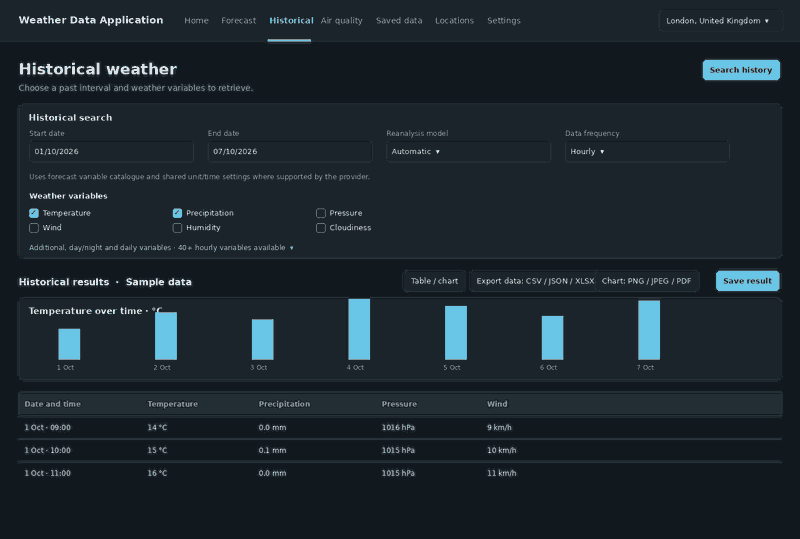
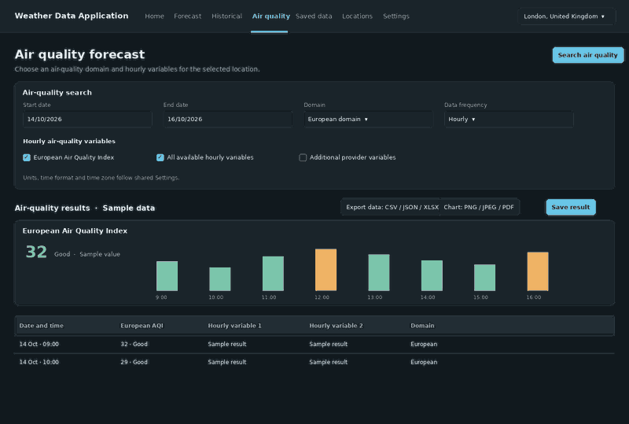
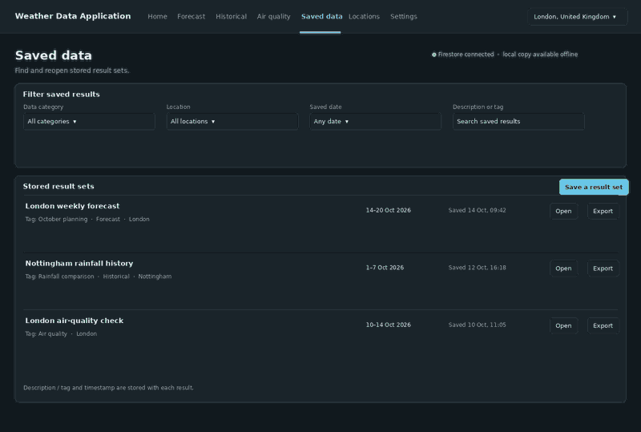
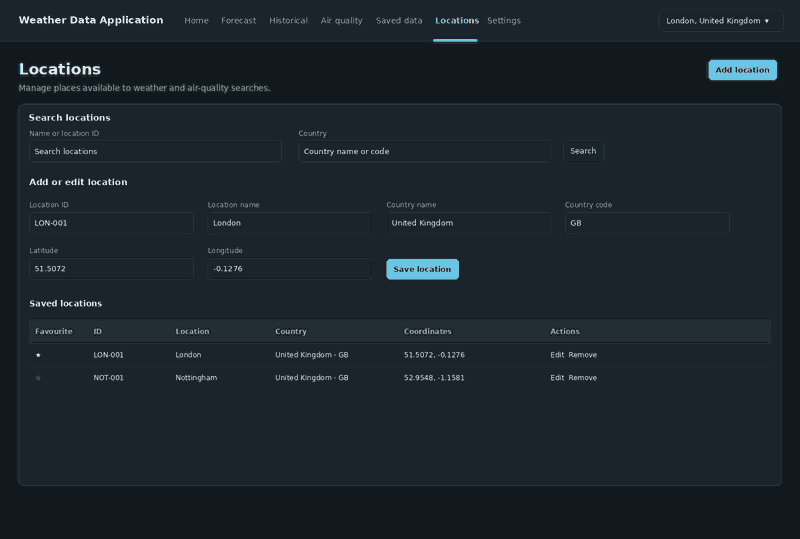
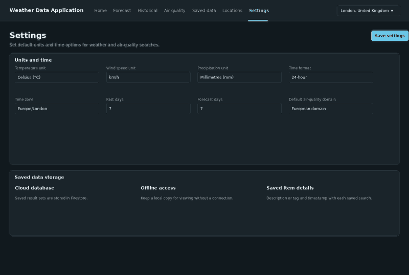

# Weather Data Application

A personal Python project for exploring weather and climate data. The aim is to build the application from the requirements up, understand how each part works, and practise the full development process: planning, designing, implementing, testing, and documenting a software system.

## Project status

**Design and requirements stage.** The screens below are mock-ups with sample data; the Python application and API integration have not been implemented yet.

## Planned features

- Manage saved locations, including country details, coordinates, search, editing, removal, and favourites.
- Search weather forecasts by location, date range, model, units, and selected hourly or daily variables.
- Search historical weather over a chosen interval using available reanalysis data.
- Search hourly air-quality forecasts, including the European Air Quality Index and a selected domain.
- View results in tables and charts, and export data as CSV, JSON, or XLSX and charts as PNG, JPEG, or PDF.
- Save forecast, historical, and air-quality result sets with descriptions or tags and timestamps; browse saved results and support offline viewing.

The eventual data provider and the exact variables available will be chosen during implementation. Open-Meteo is one possible provider from the original brief.

## Page mock-ups

The interactive design file is [`weather-data-all-pages.html`](docs/design/weather-data-all-pages.html). It contains seven pages in one application shell. The screenshots are included here for quick review; they show sample interface content rather than live weather data. The page designs now use the dark blue colour scheme shown in the updated Home screen.

I’ve left [`hand-drawn-sketches/`](docs/design/hand-drawn-sketches/) ready for photos of the paper sketches.

### Home

### Forecast

### Historical weather

### Air quality

### Saved data

### Locations

### Settings

## Planned implementation approach

The Python implementation will be developed in small steps so each feature can be understood and verified before adding the next one. Initial work will establish the project structure and location model, then add forecast requests and result display. Historical data, air quality, exports, and saved/offline data can follow as separate milestones.

## Source requirements

This project follows the supplied Weather Data Application brief and its requirements REQ-1 through REQ-26. Some details in the brief, such as the full list of extra provider variables and the meaning of the air-quality “domain” option, need to be resolved against the chosen API before implementation.
