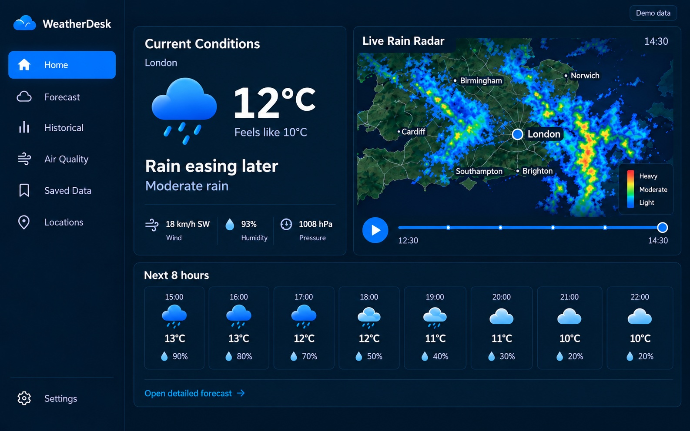
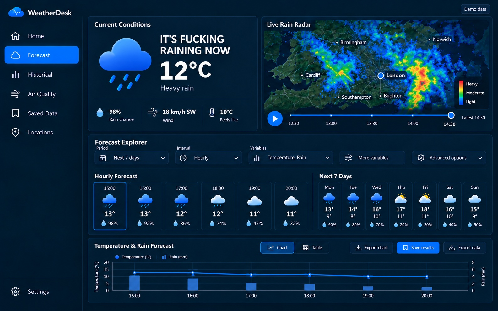
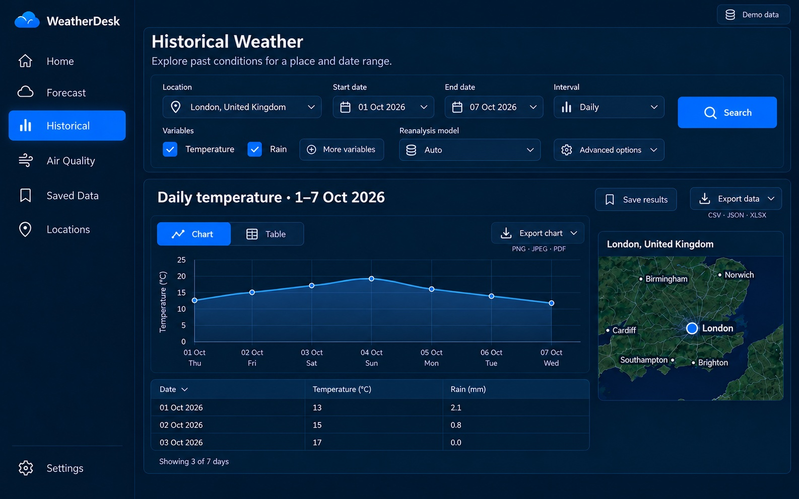
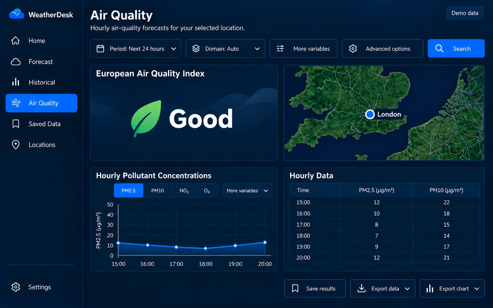
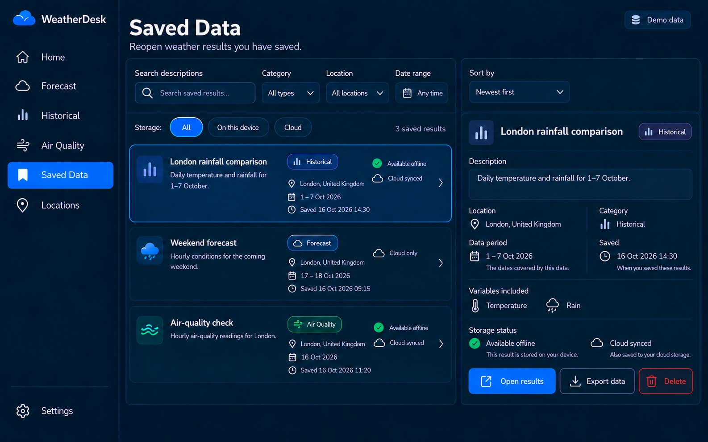
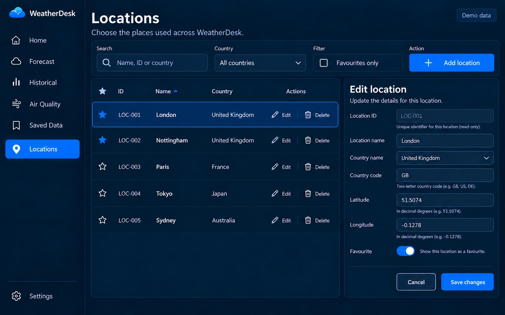
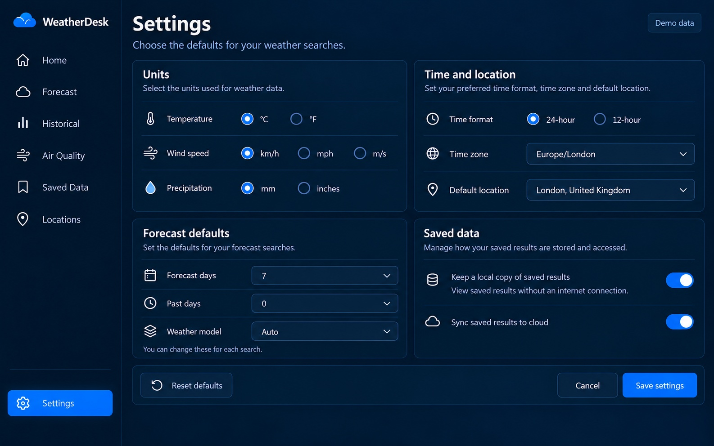

# Live Radar Design

Latest screen revisions — 17 October 2026.

These visual mock-ups use sample data. The shared top location bar has been removed. Forecast Explorer and both forecast summaries share one panel; Air Quality and Locations use the revised alignment. The Air Quality Index summary retains its status with the legend removed. Settings is included as a full-size screen.

## Home

## Forecast

## Historical weather

## Air quality

## Saved data

## Locations

## Settings

## Earlier concept

The [original overview board](screenshots/all-pages-board.jpg) is retained as an earlier concept; the individual images above are the current designs.
